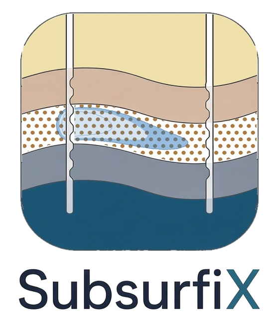
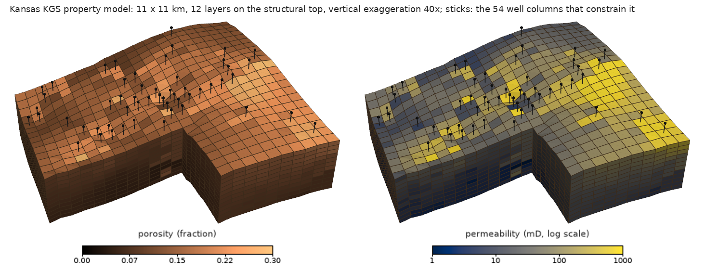
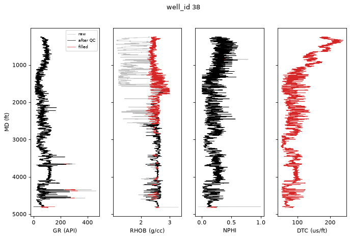
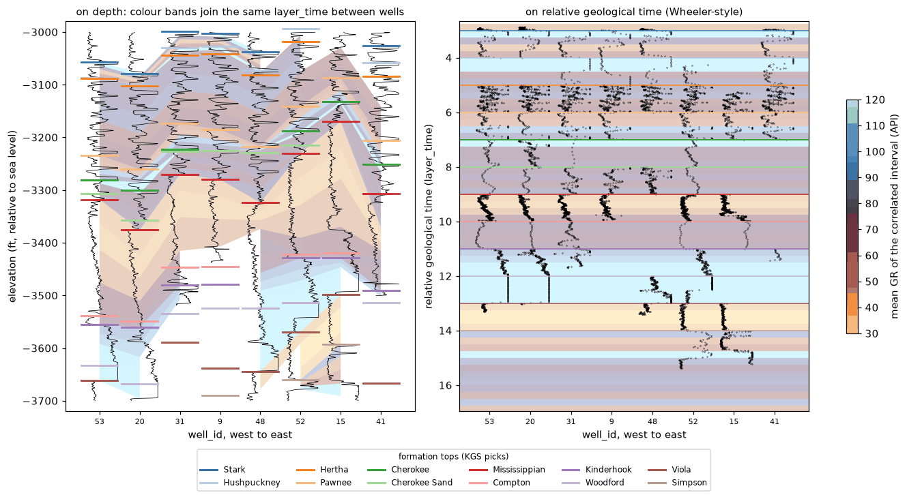
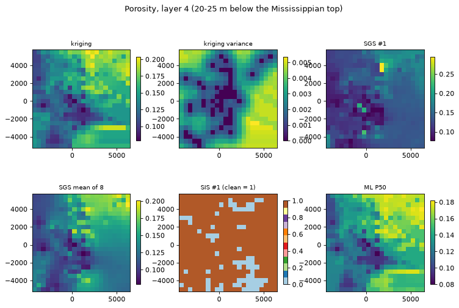
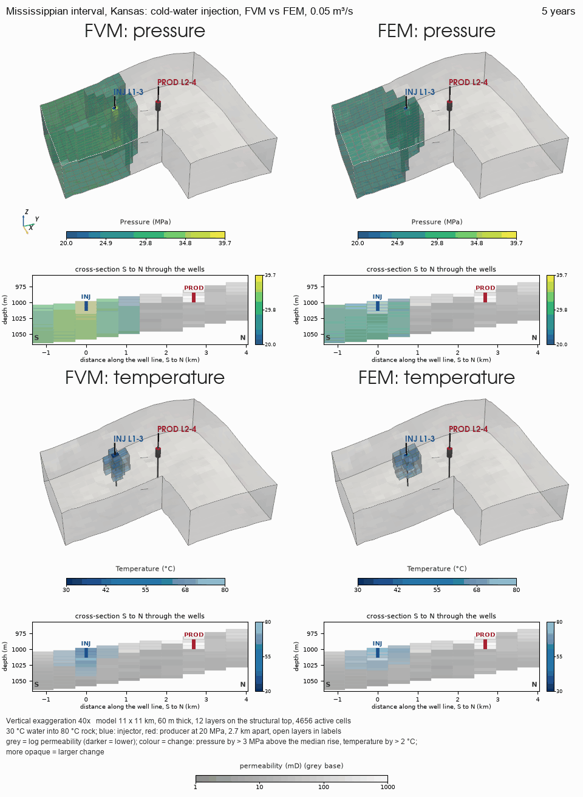
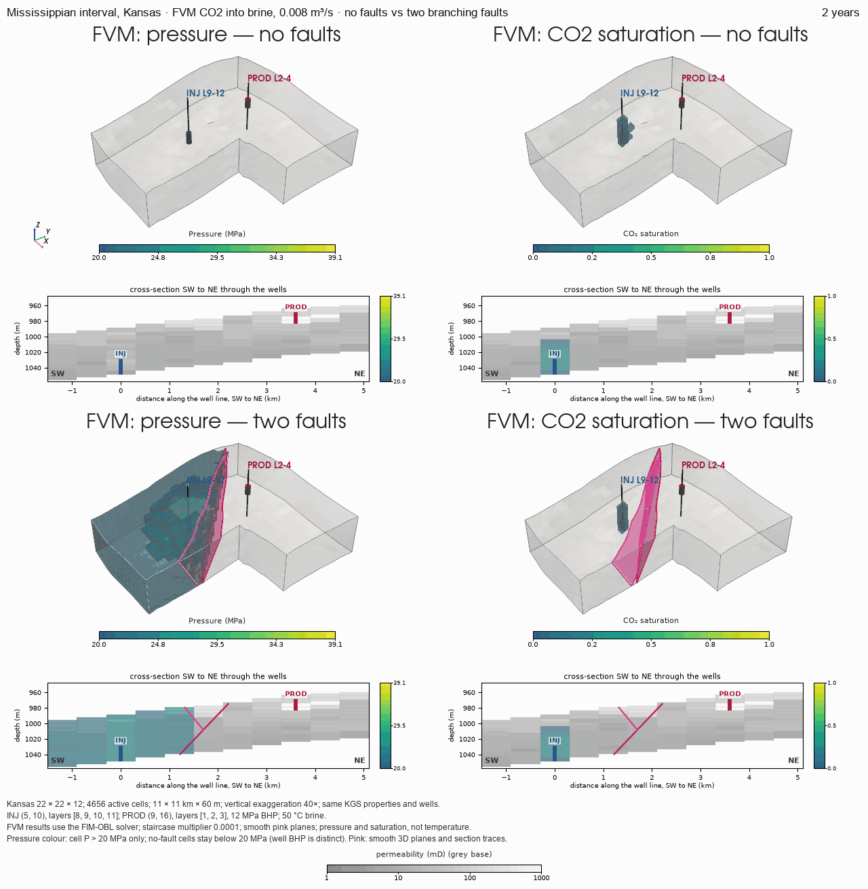
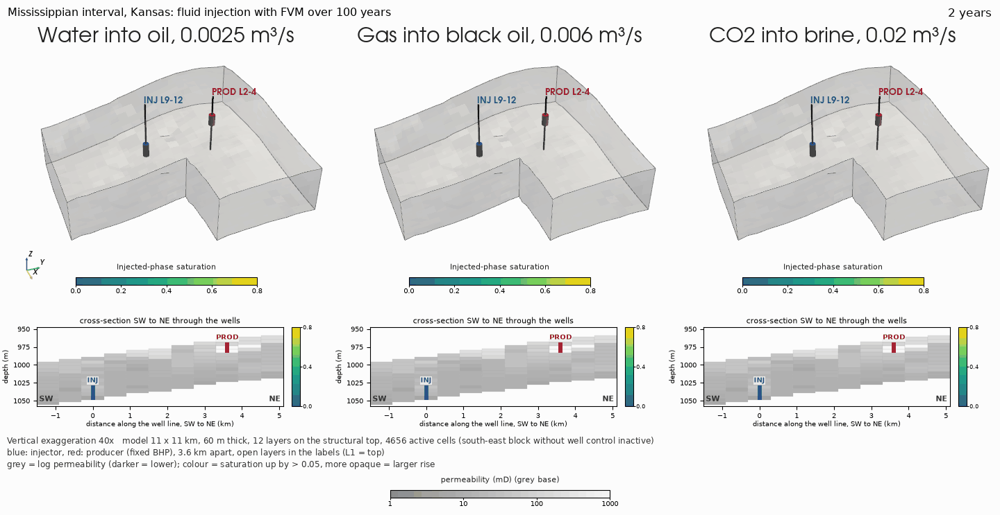

<p align="center"></p>
<p align="center">
<a href="https://doi.org/10.5281/zenodo.23832007"></a> <a href="https://github.com/GeoLarryLai/SubsurfiX/blob/main/LICENSE"></a>
<br>
<a href="https://pypi.org/project/subsurfix/"></a> <a href="https://pypi.org/project/subsurfix/"></a> <a href="https://pepy.tech/projects/subsurfix"></a> <a href="https://anaconda.org/conda-forge/subsurfix"></a> <a href="https://anaconda.org/conda-forge/subsurfix"></a>
</p>

# SubsurfiX

> [!WARNING]
> **SubsurfiX** is under active development, and many functions are still experimental and not fully validated. Please use with caution.

**SubsurfiX** is developed to automate workflows for subsurface geological analysis and reservoir modeling, including (1) machine-learning (ML) or statistically assisted well-log quality control (QC) and data-gap prediction, (2) core-to-log calibration and 3D property modeling, (3) Dynamic Time Warping (DTW) assisted stratigraphic correlation between wells, and (4) flow and heat simulations for injection–production purposes. The core is written in [Rust](https://www.rust-lang.org/) and wrapped in a Python skin.

## Installation

```bash
pip install subsurfix
```
or from `conda-forge` repository with `conda`:
```bash
conda install subsurfix
```

Python 3.12 or newer. Prebuilt wheels are for macOS arm64; on other systems pip builds from source, which needs
Rust, a C/C++ compiler and libclang. Building from a clone, and installing the [MODFLOW 6](https://www.usgs.gov/software/modflow-6-usgs-modular-hydrologic-model) (the U.S. Geological Survey modular hydrologic model; Langevin et al., 2017) program
for examples 09 and 10, are covered in [`examples/README.md`](examples/README.md#setup).

## Quick start

```python
import subsurfix as sx

toml = sx.write_demo_project("sx_demo")   # a small made-up project, no data needed
sx.prepare_edges(toml)
sx.Project(toml).run()                    # clean, fill, correlate and export the logs
```

To start on your own logs, `sx.init_project("my_project", las_dirs=["las"])` writes a settings file you can edit.
More options, including the command line, are in [`examples/README.md`](examples/README.md#quick-start-details).

## Citation

Lai, L.S.-H. (2026) SubsurfiX. *Zenodo*, [https://doi.org/10.5281/zenodo.23832007](https://doi.org/10.5281/zenodo.23832007)

## Model


*3D property model from 60 Kansas wells (11 × 11 km, 12 layers, vertical exaggeration 40×), the end product of the log-to-model workflow. Left: porosity. Right: permeability (log scale), derived from porosity (k = 10^(−1 + 14 φ) mD, doubled in clean rock; notebook 05).*

- **Log clean-up and gap filling.** Read LAS files and well surveys, mark bad sections, and fill gaps with rules
  and machine learning ([LightGBM](https://lightgbm.readthedocs.io)). Every value carries a code that says
  whether it was measured or filled.
- **Well correlation.** Match the same beds from well to well automatically, solving all wells together.
- **Grids and properties.** Build regular grids, or corner-point grids with faults (the GRDECL format used by
  industry reservoir tools), and fill them with porosity and rock type by kriging, simulation or machine learning,
  with low/mid/high (P10/P50/P90) cases. Rock types: sandstone, shale, limestone, dolomite and cherty carbonate.
- **Data exchange.** [Leapfrog](https://www.seequent.com/products-solutions/leapfrog-geo/) through
  [OMF](https://github.com/gmggroup/omf) files, and [OpenGeoSys](https://www.opengeosys.org) (an open-source
  finite-element code for coupled thermal, hydraulic, mechanical and chemical processes; Kolditz et al., 2012)
  mesh files (`.vtu`).

<table>
<tr>
<td></td>
</tr>
<tr>
<td>One Kansas well: the raw log (grey), what the clean-up kept (black) and the filled samples (red).</td>
</tr>
<tr>
<td></td>
</tr>
<tr>
<td>Eight Kansas wells, west to east, with the formation tops picked by the Kansas Geological Survey (KGS). Left: by
depth, colour bands join the same interval from well to well. Right: the same wells on relative geological time from
the dynamic time warping (DTW) correlation, where the beds line up.</td>
</tr>
<tr>
<td></td>
</tr>
<tr>
<td>Porosity in one grid layer, 20–25 m below the Mississippian top (the top of the Mississippian carbonates, 952–1029 m
below sea level in these wells), mapped by four methods. Each box is one method, each map has its own colour bar, and
triangles are the well data in that layer.
<ul>
<li><b>Kriging</b>, estimate and variance from one run: the smooth best estimate and how uncertain it is (Matheron 1963).</li>
<li><b>Sequential Gaussian simulation (SGS)</b>, one realization and the mean of 8: equally likely porosity maps (Deutsch &amp; Journel 1998, GSLIB).</li>
<li><b>Sequential indicator simulation (SIS)</b>, one realization: clean or tight rock (Journel 1983; Deutsch &amp; Journel 1998, GSLIB).</li>
<li><b>Machine learning (ML) P50</b>: the median of a quantile regression forest (Meinshausen 2006).</li>
</ul>
See notebook 04.</td>
</tr>
</table>

Each step has an executed notebook on open data from the KGS and FORCE 2020; see
[`examples/README.md`](examples/README.md).

## Fundamentals

Flow and heat simulations in SubsurfiX rest on two balances:

- **Mass balance with Darcy's law.** In every small piece of rock, fluid that flows in minus fluid that flows out
  equals the change in fluid stored. Darcy's law says how fast fluid flows: faster through more permeable rock,
  for a bigger pressure difference, and for a thinner (less viscous) fluid. With several fluids (water, oil, gas,
  CO₂), each one has its own balance and they share the pore space.
- **Energy balance (heat transport).** Heat is carried along by moving fluid and also spreads by conduction
  through rock and fluid; the heat stored in a cell changes by what flows in and out.

The governing physics is mass conservation plus Darcy-type flow, with optional heat or multiphase
extensions. FVM and FEM can discretize the same governing equations; a fair comparison also matches
constitutive properties, initial and boundary conditions, wells, and the enabled physics.

**Methods.** The **finite-volume method (FVM)** balances fluxes for each cell: an internal connection
contributes equal and opposite fluxes to its two cells. The implemented FVM uses a **two-point flux
approximation**, with **non-neighbour connections** where needed across faults. The **finite-element
method (FEM)** instead assembles a weak form using element shape functions; the FEM formulation here is
**continuous Galerkin**. Use FVM and FEM as the method labels in plots and comparisons.

**Meshes.** A **corner-point grid** describes cells using pillars and corner depths. **Bulk mesh** means
the volume mesh of the domain, rather than a boundary mesh; it is not a synonym for unstructured mesh
and is not a different physical model. These mesh names do not imply that both methods already support
both mesh types. The FVM solver supports regular and corner-point grids. The experimental FEM solver supports water flow
and heat on regular grids and valid face-to-face corner-point hexahedra; it rejects faulted grids. Conforming hexahedral bulk-mesh input is available through `FlowModel.from_bulk_mesh` for both
methods; its FVM connections require planar, permeability-orthogonal faces. General skew/polyhedral
fluxes and fault-interface treatment for FEM are not yet implemented.

**Discretization and solvers.** Discretization turns continuous equations into a finite algebraic system:
FVM or FEM specifies the spatial discretization, and a time scheme specifies the temporal discretization.
The **FVM solver** for the fully implicit results is the **FIM-OBL solver**: **fully implicit method (FIM)**
with **operator-based linearization (OBL)**. It uses backward Euler time stepping and solves the coupled
unknowns together with Newton iterations and tabulated operators. Other FVM routines use implicit pressure
and explicit saturation or separate heat transport; FVM does not itself imply fully implicit coupling.
The **FEM solver** is a **continuous Galerkin finite-element solver** (OpenGeoSys-style FEM); it supports the experimental water-flow and heat workflow described below, not general multiphase flow. “Solver” means the numerical
implementation; “linear solver” and “nonlinear solver” name its algebraic components. Implementation
names such as `run_fim_*` remain unchanged.

## Methods and solvers

FVM and FEM are the two spatial methods. The package provides **two FVM solvers**:
1. An **open-DARTS-inspired FIM-OBL solver** (fully implicit method with operator-based linearization).
2. A **MODFLOW-inspired control-volume finite-difference solver**, translated into Rust for the
   single-fluid pressure and heat routines. This is not the official USGS MODFLOW 6 program.

FEM here uses one **OpenGeoSys-style continuous Galerkin finite-element solver**. Experimental FEM
supports coupled water pressure and temperature; complete multiphase simulation remains FVM-only.

The featured Kansas cold-water animation compares **FVM and FEM pressure and temperature** in a
2 × 2 layout: FVM pressure | FEM pressure, above FVM temperature | FEM temperature. The FVM results
use the FIM-OBL solver; FEM uses the OpenGeoSys-style continuous Galerkin finite-element solver.
These are coupled thermal-water results, not multiphase saturation panels. Separate official MODFLOW 6
external checks remain in notebooks 09/10; neither MODFLOW implementation appears in this figure.

These references inspired the in-package Rust implementations; the separate official MODFLOW 6 external checks call its program through FloPy:

- [open-DARTS](https://gitlab.com/open-darts/open-darts) (open Delft Advanced Research Terra Simulator), a finite-volume simulator:
  Voskov et al. (2024); Voskov (2017); Khait and Voskov (2017).
- [MRST](https://www.sintef.no/projectweb/mrst/) (MATLAB Reservoir Simulation Toolbox), SINTEF's open-source MATLAB
  toolbox for reservoir simulation: Lie (2019); Lie and Møyner (2021); for CO₂ vertical equilibrium, Nilsen et al.
  (2011, 2016).
- [MODFLOW 6](https://www.usgs.gov/software/modflow-6-usgs-modular-hydrologic-model), the U.S. Geological Survey
  modular hydrologic model: Langevin et al. (2017); run through [FloPy](https://github.com/modflowpy/flopy):
  Bakker et al. (2016).

| Solver or reduced model | Fluids | Thermo | Grids | Pros & Cons |
|---|---|---|---|---|
| **FVM — FIM-OBL solver** (default fully implicit solver): using the fully implicit method with operator-based linearization (fluid properties from pre-computed tables)<br><sub>Adapted from [open-DARTS](https://gitlab.com/open-darts/open-darts)</sub> | Water, water–oil, oil–gas, CO₂–brine | ✅ | Regular, corner-point (faulted) | 👍: every fluid system plus heat<br>👎: slower than MODFLOW 6 and VE |
| **FVM — MODFLOW-inspired control-volume finite-difference solver** (Rust translation): single-fluid pressure and separate heat transport (`run_pressure`, `run_heat`) | Water only | ✅ | Regular, corner-point | 👍: in-package Rust routines<br>👎: not the coupled multiphase FIM-OBL solver |
| **External FVM check — USGS MODFLOW 6**: official groundwater flow and energy transport<br><sub>[MODFLOW 6](https://www.usgs.gov/software/modflow-6-usgs-modular-hydrologic-model) through [FloPy](https://github.com/modflowpy/flopy)</sub> | Water only | ✅ | Regular | 👍: widely tested reference, fast<br>👎: single fluid; needs the `mf6` program |
| **FEM** (experimental): continuous Galerkin finite-element water flow and heat (OpenGeoSys-style FEM), with pressure and temperature at the cell corners<br><sub>After [OpenGeoSys](https://www.opengeosys.org)</sub> | Water only | ✅ | Regular, corner-point without faults | 👍: same water, rock and wells as FVM, so the two compare directly (notebook 15)<br>👎: experimental, not yet checked against OpenGeoSys; closed outer boundary only |
| **CO₂ vertical-equilibrium (VE) model**<br><sub>Based on [MRST](https://www.sintef.no/projectweb/mrst/)</sub> | CO₂–brine | ❌ | Regular, corner-point (top surface) | 👍: runs in seconds; structural and residual trapping<br>👎: CO₂ as a thin layer under the caprock; no dissolution |


Corner-point grids are grid input, not a competing solver: the GRDECL reader builds fault-overlap
connections for FVM. Fault-rock effects enter through transmissibility multipliers; the vertical-equilibrium
model uses the top surface.

**Linear solver and running several cases.** The fully implicit FVM solver solves each time step iteratively by default: GMRES
(generalized minimal residual; Saad and Schultz, 1986) with a CPR (constrained pressure residual; Wallis, 1983)
preconditioner and algebraic multigrid (Notay, 2010), falling back to a direct solve if needed
(`linear_solver="direct"` forces it; same answers, slower). `subsurfix.parallel.run_cases` runs several cases in
parallel.

**Well correlation.** SubsurfiX uses the dynamic time warping (DTW) algorithm to correlate wells by placing all of
them on a shared relative geologic time axis (Wheeler and Hale, 2014).
- Formation tops act as fixed tie points that the match must honour, an idea shown by Samant et al. (2025). All the
  well-to-well pairwise matches between formation tops follow Lai et al. (2026) and Samant et al. (2025). Picks that
  disagree with nearby wells are flagged for checking instead of being moved.
- Finer sub-horizons are suggested by looking for repeated patterns at several scales in the preprocessed log,
  following Sylvester (2023).
- All pairwise DTW matches across this network are then solved together as one least-squares problem to find the
  correlation consensus. SubsurfiX first links each well to its nearest neighbours (k-nearest neighbours, kNN) and
  to its Delaunay neighbours. A minimum spanning tree (Kruskal, 1956) keeps the whole field connected, and a robust
  Tukey biweight (Beaton and Tukey, 1974) reweights each match, so a poor match between two wells is down-weighted.

### FVM versus FEM: Kansas water-injection pressure and temperature

**Purpose:** compare FVM and FEM pressure and temperature for cold-water injection on the same unfaulted Kansas reservoir model.

<p align="center"></p>

*The FVM results use the FIM-OBL solver; FEM uses the OpenGeoSys-style continuous Galerkin finite-element solver. This comparison shows water-injection pressure and temperature, not saturation.*

The original Kansas FVM arrays were reused unchanged; only FEM was computed for this comparison.
The top row shows pressure and the bottom row temperature, with FVM on the left and FEM on the right.
This is an experimental comparison, not a claim that the two discretizations give identical results.

**Results at 200 years (FVM / FEM)**
- Producer temperature: **69.08 / 65.36 °C**; maximum producer-temperature difference over the report times: **3.72 °C**.
- First reported producer cooling greater than 1 °C: **65 / 45 years**.
- Mean absolute temperature difference over active cells and report times: **0.414 °C**; maximum: **20.42 °C**.
- Injector-column pressure: **42.174 / 32.223 MPa**; maximum final cell-pressure difference: **9.951 MPa**.
- FEM water / energy balance errors: **1.0 × 10⁻⁷ / 8.3 × 10⁻⁹**. The reused FVM cache records an original maximum balance error of **7.3 × 10⁻¹²**, not separate water/energy errors.

The producer-temperature difference exceeds the script's optional default 2 °C comparison limit;
this figure is not a pass of that limit. The FEM run took **322.7 s** on the Mac with eight solver threads.
The FVM cache records **107.3 s** for its original run; these are not a same-machine runtime benchmark.

**Shared case**
- Whole KGS model: 22 × 22 × 12 cells; 11 × 11 km and 60 m thick; 4656 active cells; unfaulted structural grid.
- 0.05 m³/s of 30 °C water into an 80 °C reservoir; injector (6, 8), open layers 1–3; producer (8, 13), layers 2–4, held at 20 MPa.
- No gravity; same water/rock constitutive model and 0.25-year maximum time step; FEM streamline-upwind stabilization factor 1.
- Forty report times, every five years through year 200; the GIF includes its final-frame hold.

Renderer: `scripts/make_fem_vs_fim_animation.py`. `--fvm-from-npz` reuses the original FVM heat cache
and computes FEM only; `--save-fem-npz` and `--save-npz` retain the new results; `--from-npz` renders
both columns without solving again. The earlier one-row FVM-only crop remains in
`image/methods_compare_kansas.gif`, but is not this FVM-versus-FEM comparison.

### Kansas FVM CO₂ into brine: no faults versus two branching faults

**Purpose:** show how two branching, low-permeability faults change pressure build-up and CO₂ spreading for the same injection on the Kansas model, using the FIM-OBL solver under FVM.

<p align="center"></p>

<sub>Kansas 22×22×12 · CO₂/brine, 0.008 m³/s, producer held at 20 MPa, 100 yr · same 5–200 MPa table, 261×201 points.</sub>

*The FVM results use the FIM-OBL solver. Both rows use the Kansas structural model with the same wells and CO₂-into-brine setup. The lower row adds two no-throw branching staircase barriers (main 3.75° SW; branch 4.67° NE soling into the main; multiplier 10⁻⁴). Pink/magenta surfaces in the faulted 3D views and matching section traces draw the approved gentle-dip planes smoothly, not the staircase faces. This shows pressure and saturation, not temperature. FEM is omitted because faulted multiphase FEM is not available.*

**Highlights (no faults / two faults)**
- Producer BHP is **20 MPa**, matching the 20 MPa initial reservoir pressure; the injector rate is **0.008 m³/s**.
- No-faults cell pressures are **20.116–24.617 MPa**, peaking at year 6 (injector BHP **27.603 MPa**) and easing to
  **22.380 MPa** by year 100. CO₂ reaches the producer at year **56** (final CO₂-rich saturation **0.670**).
- Two-faults injector-side cell pressure peaks at **47.565 MPa** at year 54 (injector BHP **52.311 MPa**), easing to
  **44.504 MPa** (BHP **49.037 MPa**) by year 100. The producer side stays near **20.2–24.6 MPa** (mean **21.05–21.27 MPa**).
  CO₂ reaches the producer at year **82** (final CO₂-rich saturation **0.598**).
- Peak reported injector BHP: **27.603 / 52.311 MPa**; final producer-cell pressure: **20.304 / 20.395 MPa**.
  Reaching the producer is a result, not an acceptance criterion.
- Component balance errors (CO₂ / water, relative to net transferred mass): **5.54×10⁻⁹ / 1.73×10⁻⁸** without faults
  and **2.46×10⁻⁹ / 1.07×10⁻⁸** with faults; no property or linear-solver fallbacks in either run.
- Pressure panels share a **20.0–47.6 MPa** `turbo` scale across both models, with cells at or below **21.5 MPa**
  left on the grey permeability base.

**Key settings**
- Whole KGS structural model: 22 × 22 × 12 cells of 500 × 500 × 5 m (11 × 11 km, 60 m thick), 4656 active cells;
  KGS porosity, permeability and structural top unchanged; vertical exaggeration 40×.
- Injector (5, 10), open in layers 8–11, 0.008 m³/s of CO₂; producer (9, 16), layers 1–3, 20 MPa BHP (zero-based
  indices). 50 °C, 1 mol/kg brine; initial pressure 20 MPa; gravity on; 100 years, reported every two years.
- Faults: no throw and no cut-plane mesh; a staircase transmissibility multiplier of 10⁻⁴ on 477 of 13,052
  connections. The pink surfaces and section traces draw the geometric fault planes.
- Constitutive tables: 5–200 MPa, 261 × 201 points, identical in both cases.
- Camera: starts slightly from the SSE (`view_dir=(0.88, -0.60, 0.75)`) and turns 35° (`rotate_deg`) to an
  almost-east view; `rotate=False` fixes it.

**Scientific notes**
- The Spycher & Pruess (2005) CO₂–brine flash is valid to **60 MPa (600 bar)**; the wider 5–200 MPa table only keeps
  the numerical iterations inside the tabulated range. At 0.02 m³/s the faulted case left the valid property range
  (95,402 property fallbacks), so both cases share the lower rate of 0.008 m³/s.
- The faulted 52.311 MPa injector BHP is well above a rough lithostatic estimate of ~25.46 MPa at the mean open depth
  (~1.04 km, 2500 kg/m³ bulk density; about 2.05× that estimate). That estimate is illustrative, not a site measurement
  or an operating limit. The model has no fracture opening or geomechanics, so this result does not establish field
  feasibility.

[Notebook 12](examples/12_multiphase_fluids.ipynb) exposes these as editable Python settings (`RATE_M3_S`,
`PROD_BHP_PA`, `P_RANGE_PA`, `TABLE_POINTS`, `YEARS`, `FAULT_MULTIPLIER`, wells and layers, `N_THREADS`, `VIEW_DIR`, `ROTATE`,
`ROTATE_DEG`) and passes them to `run_comparison` in `scripts/make_faulted_co2_kansas.py`. The whole-Kansas solve is
off by default (`RUN_FAULTED_COMPARISON = False`); separate `DEMO_*` settings drive the small notebook demos, and the
script's `--from-npz` option re-renders from saved results without solving.

### Same FVM solver, different fluids: water, gas and CO₂ on the Kansas model

**Purpose:** show how three injected fluids (water into oil, gas into a black oil, carbon dioxide (CO₂) into brine)
spread through the same reservoir with the FIM-OBL solver under FVM.

<p align="center"></p>

*All three runs use the FIM-OBL solver under FVM; labels were refreshed from the original frames without rerunning the simulations.*

**Highlights**
- CO₂ reaches the producer after 20 years and gas after 32 years.
- The water front stays within about 2 km of the injector and does not reach the producer in 100 years.
- Mass-balance errors stay below 2e-9 in all three runs.

**Key settings**
- Whole KGS model (22 × 22 × 12 cells), 100 years; injector and producer 3.6 km apart.
- Rates: 0.0025 m³/s water, 0.006 m³/s gas, 0.02 m³/s CO₂.

In the animations the grey shell shows permeability (log scale) and coloured cells show where the injected fluid
or the temperature change is. Details: `scripts/kansas_fluids.py`; a fast small version is in notebook 12.

## References

**Porous-media flow (water, oil, gas, CO₂–brine)**
- Langevin, C. D., et al. (2017). Documentation for the MODFLOW 6 groundwater flow model. USGS Techniques and
  Methods 6-A55. <https://doi.org/10.3133/tm6A55>
- Bakker, M., et al. (2016). Scripting MODFLOW model development using Python and FloPy. *Groundwater* 54(5).
  <https://doi.org/10.1111/gwat.12413>
- Peaceman, D. W. (1983). Interpretation of well-block pressures in numerical reservoir simulation with
  nonsquare grid blocks and anisotropic permeability. *SPE Journal* 23(3). <https://doi.org/10.2118/10528-PA>
- Voskov, D., Saifullin, I., Novikov, A., Wapperom, M., et al. (2024). open Delft Advanced Research Terra Simulator
  (open-DARTS). *Journal of Open Source Software*. <https://doi.org/10.21105/joss.06737>
- Voskov, D. V. (2017). Operator-based linearization approach for modeling of multiphase multi-component flow in
  porous media. *Journal of Computational Physics* 337, 275–288. <https://doi.org/10.1016/j.jcp.2017.02.041>
- Khait, M., Voskov, D. V. (2017). Operator-based linearization for general purpose reservoir simulation.
  *Journal of Petroleum Science and Engineering* 157, 990–998. <https://doi.org/10.1016/j.petrol.2017.08.009>
- Spycher, N., Pruess, K. (2005). CO₂–H₂O mixtures in the geological sequestration of CO₂. II. Partitioning in
  chloride brines at 12–100 °C and up to 600 bar. *Geochimica et Cosmochimica Acta* 69(13), 3309–3320.
  <https://doi.org/10.1016/j.gca.2005.01.015>
- Ziabakhsh-Ganji, Z., Kooi, H. (2012). An equation of state for thermodynamic equilibrium of gas mixtures and
  brines to allow simulation of the effects of impurities in subsurface CO₂ storage. *International Journal of
  Greenhouse Gas Control* 11. <https://doi.org/10.1016/j.ijggc.2012.07.025>
- Nordbotten, J. M., Celia, M. A. (2006). Similarity solutions for fluid injection into confined aquifers.
  *Journal of Fluid Mechanics* 561, 307–327. <https://doi.org/10.1017/S0022112006000802>
- Nilsen, H. M., et al. (2011). Field-case simulation of CO₂-plume migration using vertical-equilibrium models.
  *Energy Procedia* 4, 3801–3808. <https://doi.org/10.1016/j.egypro.2011.02.315>
- Nilsen, H. M., Lie, K.-A., Andersen, O. (2016). Fully-implicit simulation of vertical-equilibrium models with
  hysteresis and capillary fringe. *Computational Geosciences* 20, 49–67.
  <https://doi.org/10.1007/s10596-015-9547-y>
- Lie, K.-A. (2019). *An Introduction to Reservoir Simulation Using MATLAB/GNU Octave* (MRST). Cambridge
  University Press. <https://doi.org/10.1017/9781108591416>
- Lie, K.-A., Møyner, O. (eds.) (2021). *Advanced Modeling with the MATLAB Reservoir Simulation Toolbox*. Cambridge
  University Press. <https://doi.org/10.1017/9781009019781>

**Heat transport**
- Ogata, A., Banks, R. B. (1961). A solution of the differential equation of longitudinal dispersion in porous
  media. USGS Professional Paper 411-A. <https://doi.org/10.3133/pp411A>
- Khait, M., Voskov, D. (2018). Operator-based linearization for efficient modeling of geothermal processes.
  *Geothermics* 74, 7–18. <https://doi.org/10.1016/j.geothermics.2018.01.012>
- Kolditz, O., et al. (2012). OpenGeoSys: an open-source initiative for numerical simulation of
  thermo-hydro-mechanical/chemical (THM/C) processes in porous media. *Environmental Earth Sciences* 67.
  <https://doi.org/10.1007/s12665-012-1546-x>; <https://www.opengeosys.org>
- MODFLOW 6 groundwater energy transport (GWE), USGS. <https://www.usgs.gov/software/modflow-6-usgs-modular-hydrologic-model>
- IAPWS-IF97 water properties (used by the FVM solver for water). <https://iapws.org/technical-guidance/release/IF97-Rev>

**Linear solvers**
- Saad, Y., Schultz, M. H. (1986). GMRES: a generalized minimal residual algorithm for solving nonsymmetric linear
  systems. *SIAM Journal on Scientific and Statistical Computing* 7(3), 856–869. <https://doi.org/10.1137/0907058>
- Wallis, J. R. (1983). Incomplete Gaussian elimination as a preconditioning for generalized conjugate gradient
  acceleration. SPE Reservoir Simulation Symposium, SPE 12265. <https://doi.org/10.2118/12265-MS>
- Notay, Y. (2010). An aggregation-based algebraic multigrid method. *Electronic Transactions on Numerical
  Analysis* 37, 123–146. <https://etna.ricam.oeaw.ac.at/volumes/2001-2010/vol37/abstract.php?pages=123-146>

**Well logs, correlation and property modelling**
- Gonzalez, K., et al. (2023). Machine learning workflow for log data. TGS technical library.
  <https://www.tgs.com/technical-library/machinelearningworkflowforlogdata>
- Wheeler, L., Hale, D. (2014). Simultaneous correlation of multiple well logs. *SEG Technical Program Expanded
  Abstracts 2014*. <https://doi.org/10.1190/segam2014-0227.1>
- Sylvester, Z. (2023). Automated multi-well stratigraphic correlation and model building using relative
  geologic time. *Basin Research*. <https://doi.org/10.1111/bre.12787>
- Samant, R., et al. (2025). Enhancing the accuracy of dynamic time warping by integrating stratigraphic
  constraints. *Paleoceanography and Paleoclimatology*. <https://doi.org/10.1029/2024PA005082>
- Lai, L. S.-H., Sylvester, Z., Covault, J. A., Gomberg, J. S., Nieminski, N. M. (2026). Reproducible
  event-bed correlation with uncertainty: pyCoreRelator. *Sedimentology*. <https://doi.org/10.1111/sed.70163>
- Kruskal, J. B. (1956). On the shortest spanning subtree of a graph and the traveling salesman problem.
  *Proceedings of the American Mathematical Society* 7(1), 48–50. <https://doi.org/10.1090/S0002-9939-1956-0078686-7>
- Beaton, A. E., Tukey, J. W. (1974). The fitting of power series, meaning polynomials, illustrated on
  band-spectroscopic data. *Technometrics* 16(2), 147–185. <https://doi.org/10.1080/00401706.1974.10489171>
- Daly, C. (2021). An application of an embedded model estimator to a synthetic nonstationary reservoir model.
  *Frontiers in Artificial Intelligence* 4. <https://doi.org/10.3389/frai.2021.624697>
- Daly, C. (2022). An embedded model estimator for non-stationary random functions using multiple secondary
  variables. *Mathematical Geosciences*. <https://doi.org/10.1007/s11004-021-09972-8>
- Matheron, G. (1963). Principles of geostatistics. *Economic Geology* 58(8), 1246–1266.
  <https://doi.org/10.2113/gsecongeo.58.8.1246>
- Journel, A. G. (1983). Nonparametric estimation of spatial distributions. *Journal of the International
  Association for Mathematical Geology* 15, 445–468. <https://doi.org/10.1007/BF01031292>
- Deutsch, C. V., Journel, A. G. (1998). *GSLIB: Geostatistical Software Library and User's Guide*, 2nd ed.
  Oxford University Press.
- Meinshausen, N. (2006). Quantile regression forests. *Journal of Machine Learning Research* 7, 983–999.
  <https://jmlr.org/papers/v7/meinshausen06a.html>

**Data sources**
- Kansas Geological Survey (KGS), well logs and formation tops. <https://www.kgs.ku.edu/>
- Bormann, P., et al. (2020). FORCE 2020 well log and lithofacies dataset for machine learning competition.
  Zenodo. <https://doi.org/10.5281/zenodo.4351155>

## Acknowledgements

The FIM-OBL solver implements FVM and follows the operator-based linearization published for
[open-DARTS](https://gitlab.com/open-darts/open-darts) (Voskov 2017; Khait & Voskov 2017, 2018; latest release
when accessed on 2026-11-01: 2.1.0). The `.vtu` mesh export writes the mesh format read by
[OpenGeoSys](https://www.opengeosys.org) (latest release when accessed on 2026-11-01: 6.5.9). The CO₂ VE relative permeabilities and the flow diagnostics are derived from
[MRST](https://www.sintef.no/projectweb/mrst/) 2026a (SINTEF Digital, GPL-3.0-or-later). Water properties follow
IAPWS-IF97 (revised release R7-97(2012)), with viscosity from IAPWS 2008 and thermal conductivity from IAPWS 2011.
The MODFLOW 6 comparisons were run with [MODFLOW 6](https://www.usgs.gov/software/modflow-6-usgs-modular-hydrologic-model)
6.7.0 and [FloPy](https://github.com/modflowpy/flopy) 3.11.0 (both by the USGS). 3D animations use
[PyVista](https://pyvista.org) 0.49.2.
Details and data credits are in [`NOTICE`](NOTICE) and the files in `docs/`.

## License

Code: **AGPL-3.0-or-later**. You are free to use, modify, and share it; anyone distributing modified code or running a modified version as a network service must share its source under the same license.
