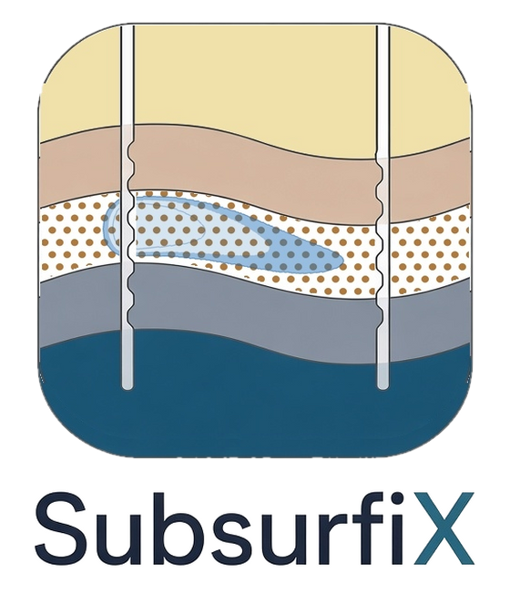
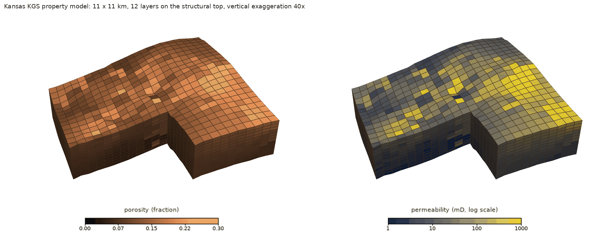
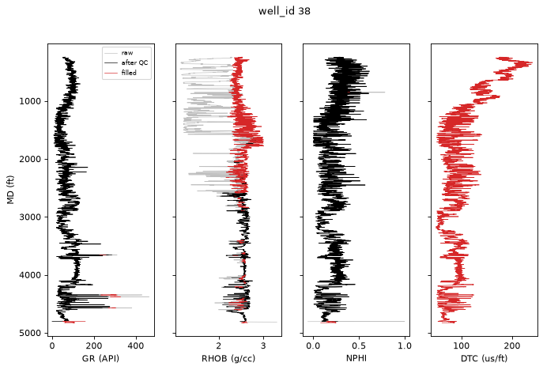
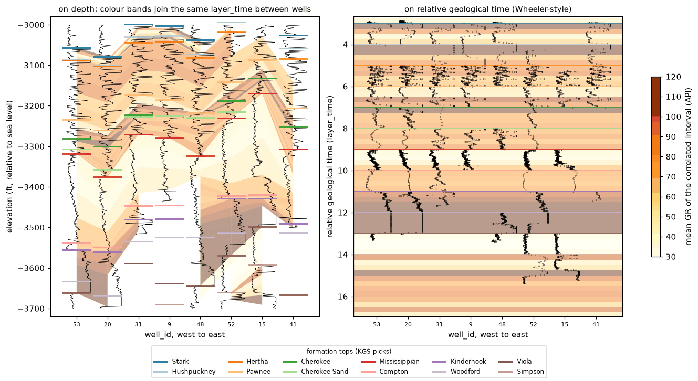
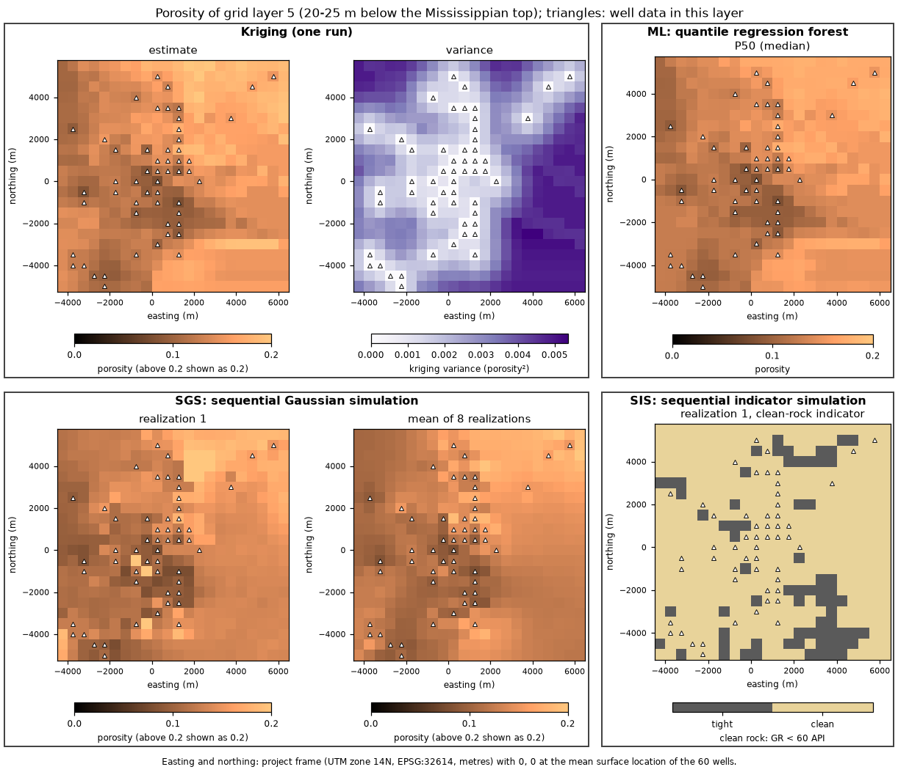
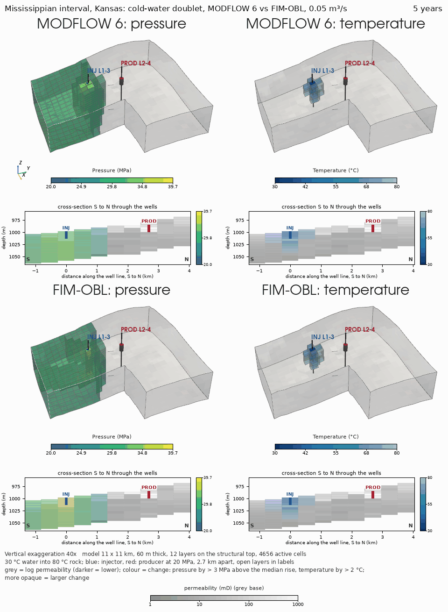
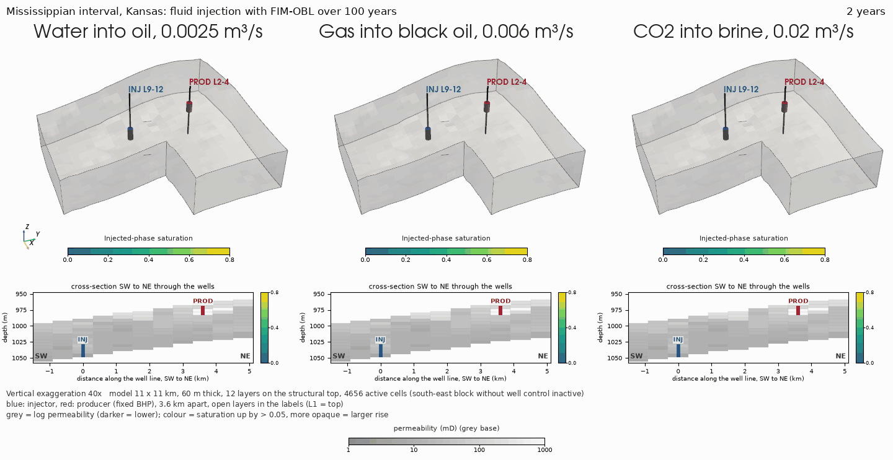

<p align="center"></p>
<p align="center">
<a href="https://doi.org/10.5281/zenodo.23832007"></a> <a href="https://github.com/GeoLarryLai/SubsurfiX/blob/main/LICENSE"></a>
<br>
<a href="https://pypi.org/project/subsurfix/"></a> <a href="https://pypi.org/project/subsurfix/"></a> <a href="https://pepy.tech/projects/subsurfix"></a> <a href="https://anaconda.org/conda-forge/subsurfix"></a> <a href="https://anaconda.org/conda-forge/subsurfix"></a>
</p>

# SubsurfiX

> [!WARNING]
> **SubsurfiX** is under active development, and many functions are still experimental and not fully validated. Please use with caution.

**SubsurfiX** is developed to automate workflows for subsurface geological analysis and reservoir modeling, including (1) machine-learning (ML) or statistically assisted well-log quality control (QC) and data-gap prediction, (2) core-to-log calibration and 3D property modeling, (3) stratigraphic correlation and top picking, and (4) flow and heat simulations for injection–production purposes. The engine is written in [Rust](https://www.rust-lang.org/) and wrapped in a Python skin.

## Installation

```bash
pip install subsurfix
```

Python 3.12 or newer. Prebuilt wheels are for macOS arm64; on other systems pip builds from source, which needs
Rust, a C/C++ compiler and libclang. Building from a clone, and installing the [MODFLOW 6](https://www.usgs.gov/software/modflow-6-usgs-modular-hydrologic-model) (the U.S. Geological Survey modular hydrologic model; Langevin et al., 2017) program
for examples 09 and 10, are covered in [`examples/README.md`](examples/README.md#setup).

## Quick start

```python
import subsurfix as sx

toml = sx.write_demo_project("sx_demo")   # a small made-up project, no data needed
sx.prepare_edges(toml)
sx.Project(toml).run()                    # clean, fill, correlate and export the logs
```

To start on your own logs, `sx.init_project("my_project", las_dirs=["las"])` writes a settings file you can edit.
More options, including the command line, are in [`examples/README.md`](examples/README.md#quick-start-details).

## Citation

Lai, L.S.-H. (2026) SubsurfiX. *Zenodo*, [https://doi.org/10.5281/zenodo.23832007](https://doi.org/10.5281/zenodo.23832007)

## Model


*3D property model from 60 Kansas wells (11 × 11 km, 12 layers, vertical exaggeration 40×), the end product of the log-to-model workflow. Left: porosity. Right: permeability (log scale), derived from porosity (k = 10^(−1 + 14 φ) mD, doubled in clean rock; notebook 05).*

- **Log clean-up and gap filling.** Read LAS files and well surveys, mark bad sections, and fill gaps with rules
  and machine learning ([LightGBM](https://lightgbm.readthedocs.io)). Every value carries a code that says
  whether it was measured or filled.
- **Well correlation.** Match the same beds from well to well automatically, solving all wells together.
- **Grids and properties.** Build regular grids, or corner-point grids with faults (the GRDECL format used by
  industry reservoir tools), and fill them with porosity and rock type by kriging, simulation or machine learning,
  with low/mid/high (P10/P50/P90) cases. Rock types: sandstone, shale, limestone, dolomite and cherty carbonate.
- **Data exchange.** [Leapfrog](https://www.seequent.com/products-solutions/leapfrog-geo/) through
  [OMF](https://github.com/gmggroup/omf) files, and [OpenGeoSys](https://www.opengeosys.org) (OGS, an open-source
  finite-element code for coupled thermal, hydraulic, mechanical and chemical processes; Kolditz et al., 2012)
  mesh files (`.vtu`).

<table>
<tr>
<td></td>
</tr>
<tr>
<td>One Kansas well: the raw log (grey), what the clean-up kept (black) and the filled samples (red).</td>
</tr>
<tr>
<td></td>
</tr>
<tr>
<td>Eight Kansas wells, west to east, with the formation tops picked by the Kansas Geological Survey (KGS). Left: by
depth, colour bands join the same interval from well to well. Right: the same wells on relative geological time from
the dynamic time warping (DTW) correlation, where the beds line up.</td>
</tr>
<tr>
<td></td>
</tr>
<tr>
<td>Porosity in one grid layer, 20–25 m below the Mississippian top (the top of the Mississippian carbonates, 952–1029 m
below sea level in these wells), mapped by four methods. Each box is one method, each map has its own colour bar, and
triangles are the well data in that layer.
<ul>
<li><b>Kriging</b>, estimate and variance from one run: the smooth best estimate and how uncertain it is (Matheron 1963).</li>
<li><b>Sequential Gaussian simulation (SGS)</b>, one realization and the mean of 8: equally likely porosity maps (Deutsch &amp; Journel 1998, GSLIB).</li>
<li><b>Sequential indicator simulation (SIS)</b>, one realization: clean or tight rock (Journel 1983; Deutsch &amp; Journel 1998, GSLIB).</li>
<li><b>Machine learning (ML) P50</b>: the median of a quantile regression forest (Meinshausen 2006).</li>
</ul>
All are SubsurfiX's own implementations based on these methods; see notebook 04.</td>
</tr>
</table>

Each step has an executed notebook on open data from the KGS and FORCE 2020; see
[`examples/README.md`](examples/README.md).

## Fundamentals

Flow and heat simulations in SubsurfiX rest on two balances:

- **Mass balance with Darcy's law.** In every small piece of rock, fluid that flows in minus fluid that flows out
  equals the change in fluid stored. Darcy's law says how fast fluid flows: faster through more permeable rock,
  for a bigger pressure difference, and for a thinner (less viscous) fluid. With several fluids (water, oil, gas,
  CO₂), each one has its own balance and they share the pore space.
- **Energy balance (heat transport).** Heat is carried along by moving fluid and also spreads by conduction
  through rock and fluid; the heat stored in a cell changes by what flows in and out.

These equations are solved on a grid of cells. SubsurfiX uses the **finite-volume** method: the model is split into
cells, and whatever leaves one cell enters its neighbour, so mass and energy are conserved exactly. Cells are
connected by two-point flux approximation (TPFA: the flow between two cells depends on their pressure
difference).

## Method overview

The methods below build on these packages; SubsurfiX does not call any of them, except MODFLOW 6 through FloPy:

- [open-DARTS](https://gitlab.com/open-darts/open-darts) (open Delft Advanced Research Terra Simulator), a finite-volume simulator:
  Voskov et al. (2024); Voskov (2017); Khait and Voskov (2017).
- [MRST](https://www.sintef.no/projectweb/mrst/) (MATLAB Reservoir Simulation Toolbox), SINTEF's open-source MATLAB
  toolbox for reservoir simulation: Lie (2019); Lie and Møyner (2021); for CO₂ vertical equilibrium, Nilsen et al.
  (2011, 2016).
- [MODFLOW 6](https://www.usgs.gov/software/modflow-6-usgs-modular-hydrologic-model), the U.S. Geological Survey
  modular hydrologic model: Langevin et al. (2017); run through [FloPy](https://github.com/modflowpy/flopy):
  Bakker et al. (2016).

| Method | Fluids | Thermo | Grids | Pros & Cons |
|---|---|---|---|---|
| **FIM-OBL** (default): fully implicit (FIM: all unknowns solved together each time step) finite-volume solver with operator-based linearization (OBL: fluid properties from pre-computed tables)<br><sub>Adapted from [open-DARTS](https://gitlab.com/open-darts/open-darts)</sub> | Water, water–oil, oil–gas, CO₂–brine | ✅ | Regular, corner-point (faulted) | 👍: every fluid system plus heat<br>👎: slowest of the three |
| **MODFLOW 6**: groundwater flow and energy transport<br><sub>[MODFLOW 6](https://www.usgs.gov/software/modflow-6-usgs-modular-hydrologic-model) through [FloPy](https://github.com/modflowpy/flopy)</sub> | Water only | ✅ | Regular | 👍: widely tested reference, fast<br>👎: single fluid; needs the `mf6` program |
| **CO₂ vertical-equilibrium (VE) model**<br><sub>Based on [MRST](https://www.sintef.no/projectweb/mrst/)</sub> | CO₂–brine | ❌ | Regular, corner-point (top surface) | 👍: runs in seconds; structural and residual trapping<br>👎: CO₂ as a thin layer under the caprock; no dissolution |
| **Corner-point faulted grids**: GRDECL reader and fault connections<br><sub>Based on [MRST](https://www.sintef.no/projectweb/mrst/)</sub> | Grid input, not a solver | – | Corner-point with faults | 👍: real faulted grids for FIM-OBL and VE<br>👎: faults are geometric overlaps; fault-rock properties only through multipliers |

**Linear solver and running several cases.** FIM-OBL solves each time step iteratively by default: GMRES
(generalized minimal residual; Saad and Schultz, 1986) with a CPR (constrained pressure residual; Wallis, 1983)
preconditioner and algebraic multigrid (Notay, 2010), falling back to a direct solve if needed
(`linear_solver="direct"` forces it; same answers, slower). `subsurfix.parallel.run_cases` runs several cases in
parallel.

### FIM-OBL against MODFLOW 6: cold-water injection on the Kansas model

**Purpose:** check that FIM-OBL (fully implicit, operator-based linearization) reproduces MODFLOW 6, the U.S. Geological Survey standard code, for water flow and heat on a real reservoir model.

<p align="center"></p>

**Highlights**
- Temperatures agree closely: the largest difference in any cell is 6.4 °C, the mean 0.31 °C.
- The cold front reaches the producer after 65 years in FIM-OBL and 40 years in MODFLOW 6; after 200 years the
  producer is at 69.1 °C and 63.5 °C.
- FIM-OBL ran in 107 s, MODFLOW 6 in 5.9 s.

**Key settings**
- Whole KGS model: 22 × 22 × 12 cells, about 11 × 11 km and 60 m thick, at 80 °C.
- 0.05 m³/s of 30 °C water for 200 years; injector and producer 2.7 km apart.

Neither run includes gravity, and MODFLOW 6 keeps water properties constant. Details:
`scripts/make_methods_animation.py`; a fast small version is in notebook 10.

### Same solver, different fluids: water, gas and CO₂ on the Kansas model

**Purpose:** show how three injected fluids (water into oil, gas into a black oil, carbon dioxide (CO₂) into brine)
spread through the same reservoir with FIM-OBL.

<p align="center"></p>

**Highlights**
- CO₂ reaches the producer after 20 years and gas after 32 years.
- The water front stays within about 2 km of the injector and does not reach the producer in 100 years.
- Mass-balance errors stay below 2e-9 in all three runs.

**Key settings**
- Whole KGS model (22 × 22 × 12 cells), 100 years; injector and producer 3.6 km apart.
- Rates: 0.0025 m³/s water, 0.006 m³/s gas, 0.02 m³/s CO₂.

In the animations the grey shell shows permeability (log scale) and coloured cells show where the injected fluid
or the temperature change is. Details: `scripts/kansas_fluids.py`; a fast small version is in notebook 12.

## References

**Porous-media flow (water, oil, gas, CO₂–brine)**
- Langevin, C. D., et al. (2017). Documentation for the MODFLOW 6 groundwater flow model. USGS Techniques and
  Methods 6-A55. <https://doi.org/10.3133/tm6A55>
- Bakker, M., et al. (2016). Scripting MODFLOW model development using Python and FloPy. *Groundwater* 54(5).
  <https://doi.org/10.1111/gwat.12413>
- Peaceman, D. W. (1983). Interpretation of well-block pressures in numerical reservoir simulation with
  nonsquare grid blocks and anisotropic permeability. *SPE Journal* 23(3). <https://doi.org/10.2118/10528-PA>
- Voskov, D., Saifullin, I., Novikov, A., Wapperom, M., et al. (2024). open Delft Advanced Research Terra Simulator
  (open-DARTS). *Journal of Open Source Software*. <https://doi.org/10.21105/joss.06737>
- Voskov, D. V. (2017). Operator-based linearization approach for modeling of multiphase multi-component flow in
  porous media. *Journal of Computational Physics* 337, 275–288. <https://doi.org/10.1016/j.jcp.2017.02.041>
- Khait, M., Voskov, D. V. (2017). Operator-based linearization for general purpose reservoir simulation.
  *Journal of Petroleum Science and Engineering* 157, 990–998. <https://doi.org/10.1016/j.petrol.2017.08.009>
- Spycher, N., Pruess, K. (2005). CO₂–H₂O mixtures in the geological sequestration of CO₂. II. Partitioning in
  chloride brines at 12–100 °C and up to 600 bar. *Geochimica et Cosmochimica Acta* 69(13), 3309–3320.
  <https://doi.org/10.1016/j.gca.2005.01.015>
- Ziabakhsh-Ganji, Z., Kooi, H. (2012). An equation of state for thermodynamic equilibrium of gas mixtures and
  brines to allow simulation of the effects of impurities in subsurface CO₂ storage. *International Journal of
  Greenhouse Gas Control* 11. <https://doi.org/10.1016/j.ijggc.2012.07.025>
- Nordbotten, J. M., Celia, M. A. (2006). Similarity solutions for fluid injection into confined aquifers.
  *Journal of Fluid Mechanics* 561, 307–327. <https://doi.org/10.1017/S0022112006000802>
- Nilsen, H. M., et al. (2011). Field-case simulation of CO₂-plume migration using vertical-equilibrium models.
  *Energy Procedia* 4, 3801–3808. <https://doi.org/10.1016/j.egypro.2011.02.315>
- Nilsen, H. M., Lie, K.-A., Andersen, O. (2016). Fully-implicit simulation of vertical-equilibrium models with
  hysteresis and capillary fringe. *Computational Geosciences* 20, 49–67.
  <https://doi.org/10.1007/s10596-015-9547-y>
- Lie, K.-A. (2019). *An Introduction to Reservoir Simulation Using MATLAB/GNU Octave* (MRST). Cambridge
  University Press. <https://doi.org/10.1017/9781108591416>
- Lie, K.-A., Møyner, O. (eds.) (2021). *Advanced Modeling with the MATLAB Reservoir Simulation Toolbox*. Cambridge
  University Press. <https://doi.org/10.1017/9781009019781>

**Heat transport**
- Ogata, A., Banks, R. B. (1961). A solution of the differential equation of longitudinal dispersion in porous
  media. USGS Professional Paper 411-A. <https://doi.org/10.3133/pp411A>
- Khait, M., Voskov, D. (2018). Operator-based linearization for efficient modeling of geothermal processes.
  *Geothermics* 74, 7–18. <https://doi.org/10.1016/j.geothermics.2018.01.012>
- Kolditz, O., et al. (2012). OpenGeoSys: an open-source initiative for numerical simulation of
  thermo-hydro-mechanical/chemical (THM/C) processes in porous media. *Environmental Earth Sciences* 67.
  <https://doi.org/10.1007/s12665-012-1546-x>; <https://www.opengeosys.org>
- MODFLOW 6 groundwater energy transport (GWE), USGS. <https://www.usgs.gov/software/modflow-6-usgs-modular-hydrologic-model>
- IAPWS-IF97 water properties (used by FIM-OBL for water). <https://iapws.org/technical-guidance/release/IF97-Rev>

**Linear solvers**
- Saad, Y., Schultz, M. H. (1986). GMRES: a generalized minimal residual algorithm for solving nonsymmetric linear
  systems. *SIAM Journal on Scientific and Statistical Computing* 7(3), 856–869. <https://doi.org/10.1137/0907058>
- Wallis, J. R. (1983). Incomplete Gaussian elimination as a preconditioning for generalized conjugate gradient
  acceleration. SPE Reservoir Simulation Symposium, SPE 12265. <https://doi.org/10.2118/12265-MS>
- Notay, Y. (2010). An aggregation-based algebraic multigrid method. *Electronic Transactions on Numerical
  Analysis* 37, 123–146. <https://etna.ricam.oeaw.ac.at/volumes/2001-2010/vol37/abstract.php?pages=123-146>

**Well logs, correlation and property modelling**
- Gonzalez, K., et al. (2023). Machine learning workflow for log data. TGS technical library.
  <https://www.tgs.com/technical-library/machinelearningworkflowforlogdata>
- Wheeler, L., Hale, D. (2014). Simultaneous correlation of multiple well logs. *SEG Technical Program Expanded
  Abstracts 2014*. <https://doi.org/10.1190/segam2014-0227.1>
- Sylvester, Z. (2023). Automated multi-well stratigraphic correlation and model building using relative
  geologic time. *Basin Research*. <https://doi.org/10.1111/bre.12787>
- Samant, R., et al. (2025). Enhancing the accuracy of dynamic time warping by integrating stratigraphic
  constraints. *Paleoceanography and Paleoclimatology*. <https://doi.org/10.1029/2024PA005082>
- Daly, C. (2021). An application of an embedded model estimator to a synthetic nonstationary reservoir model.
  *Frontiers in Artificial Intelligence* 4. <https://doi.org/10.3389/frai.2021.624697>
- Daly, C. (2022). An embedded model estimator for non-stationary random functions using multiple secondary
  variables. *Mathematical Geosciences*. <https://doi.org/10.1007/s11004-021-09972-8>
- Matheron, G. (1963). Principles of geostatistics. *Economic Geology* 58(8), 1246–1266.
  <https://doi.org/10.2113/gsecongeo.58.8.1246>
- Journel, A. G. (1983). Nonparametric estimation of spatial distributions. *Journal of the International
  Association for Mathematical Geology* 15, 445–468. <https://doi.org/10.1007/BF01031292>
- Deutsch, C. V., Journel, A. G. (1998). *GSLIB: Geostatistical Software Library and User's Guide*, 2nd ed.
  Oxford University Press.
- Meinshausen, N. (2006). Quantile regression forests. *Journal of Machine Learning Research* 7, 983–999.
  <https://jmlr.org/papers/v7/meinshausen06a.html>

**Data sources**
- Kansas Geological Survey (KGS), well logs and formation tops. <https://www.kgs.ku.edu/>
- Bormann, P., et al. (2020). FORCE 2020 well log and lithofacies dataset for machine learning competition.
  Zenodo. <https://doi.org/10.5281/zenodo.4351155>

## Acknowledgements

FIM-OBL is a finite-volume solver that follows the operator-based linearization published for
[open-DARTS](https://gitlab.com/open-darts/open-darts) (Voskov 2017; Khait & Voskov 2017, 2018; latest release
when accessed on 2026-11-01: 2.1.0). No open-DARTS code was copied, and FIM-OBL has not been checked as
equivalent to it. The `.vtu` mesh export writes the mesh format read by
[OpenGeoSys](https://www.opengeosys.org) (latest release when accessed on 2026-11-01: 6.5.9). The CO₂ VE relative permeabilities and the flow diagnostics are derived from
[MRST](https://www.sintef.no/projectweb/mrst/) 2026a (SINTEF Digital, GPL-3.0-or-later). Water properties follow
IAPWS-IF97 (revised release R7-97(2012)), with viscosity from IAPWS 2008 and thermal conductivity from IAPWS 2011.
The MODFLOW 6 comparisons were run with [MODFLOW 6](https://www.usgs.gov/software/modflow-6-usgs-modular-hydrologic-model)
6.7.0 and [FloPy](https://github.com/modflowpy/flopy) 3.11.0 (both by the USGS). 3D animations use
[PyVista](https://pyvista.org) 0.49.2.
Details and data credits are in [`NOTICE`](NOTICE) and the files in `docs/`.
