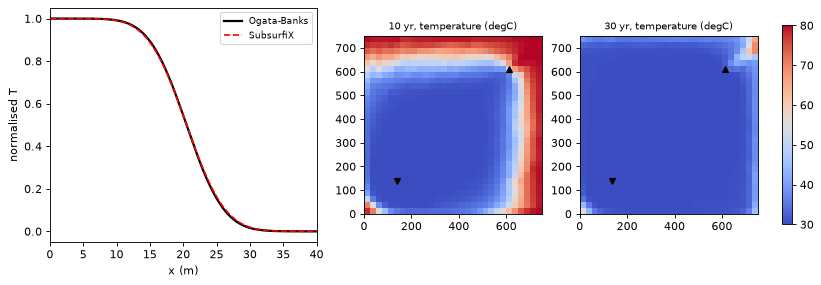

<p align="center"></p>

# SubsurfiX

[](https://pypi.org/project/subsurfix/) [](https://pepy.tech/project/subsurfix) [](https://doi.org/10.5281/zenodo.23832007) [](./LICENSE)

v0.1.0

> [!WARNING]
> **SubsurfiX** is under active development, and many functions are still experimental and not fully validated. Please use with caution.

**SubsurfiX** takes you from a folder of well logs to a checked, correlated log set and a 3D property model you can run flow and heat simulations on. I built it because these steps usually live in separate tools, and every hand-off (cleaning logs, filling gaps, correlating wells, gridding, simulating) is where things get lost or quietly changed. Here it's one project file and one run: every filled value carries a provenance code, so you always know what was measured and what was filled. The engine is in Rust, and you drive it from Python or the command line.

## Installation

```bash
pip install subsurfix
```

Prebuilt wheels are for macOS arm64; elsewhere pip builds from source, which needs Rust (stable), Python 3.10+, a C/C++ compiler and libclang (for the LightGBM build). To build from a clone:

```bash
git clone https://github.com/GeoLarryLai/SubsurfiX subsurfix && cd subsurfix
python -m venv .venv && . .venv/bin/activate
pip install maturin numpy pyarrow pandas pyproj
maturin develop -r                                    # builds subsurfix._native
pip install matplotlib lasio jupyter python-calamine  # optional: notebooks, .xls PTS files
```

Tests: `cargo test --workspace`, then `maturin develop -r --features testing` and `python -m pytest tests/python -q`.

## Citation

Lai, L.S.-H. (2026) SubsurfiX. *Zenodo*, [https://doi.org/10.5281/zenodo.23832007](https://doi.org/10.5281/zenodo.23832007)


*A 3D porosity model built from 60 Kansas wells, the end product of the whole workflow.*

## What it can do

- Read LAS files and surveys, mask bad intervals, and fill gaps (rules + LightGBM), tagging every value with a provenance code
- Correlate wells with DTW between neighbouring wells, solved as one network for all wells ([Wheeler and Hale, 2014](https://doi.org/10.1190/segam2014-0227.1); [Sylvester, 2023](https://doi.org/10.1111/bre.12787); [Samant et al., 2025](https://doi.org/10.1029/2024PA005082))
- Build regular or corner-point (GRDECL) grids, upscale, and estimate properties by kriging, SGS, SIS or ML (P10/P50/P90)
- Run pressure, tracer, two-phase water/oil and heat transport, and export to OpenGeoSys (`.vtu`)
- Run from Python (`sx.Project(...).run()`) or the command line (`subsurfix run --config project.toml`), with a built-in synthetic demo project that needs no data

## Examples


*One Kansas well, showing the raw log (grey), what QC kept (black) and the filled samples (red), so you can see exactly what was touched.*


*A west–east section with GR plotted on elevation (left) and on correlated layer time (right). On the right, the beds line up.*


*Porosity in one layer mapped four ways (kriging, SGS, SIS and ML propagation), side by side for comparison.*


*A heat transport check against the Ogata–Banks solution, plus the cold front of an injector–producer doublet moving through time.*

One executed notebook per step on open data (Kansas Geological Survey, FORCE 2020): see
[`examples/README.md`](examples/README.md). `scripts/` fetches the data.

## Quick start

```python
import subsurfix as sx

toml = sx.write_demo_project("sx_demo")   # small synthetic project, no data needed
sx.prepare_edges(toml)                    # headers, tops, surveys -> tables
p = sx.Project(toml)
p.run()                                   # ingest -> QC -> align -> normalize -> fill -> correlate -> export
print(p.status().to_pandas())
logs, tops = p.logs(well=1), p.tops()
```

Your own data: `sx.init_project("my_project", crs="EPSG:32614", las_dirs=["las"])` writes a commented
`project.toml`; `sx.template_toml()` lists every setting. Command line: `python -m subsurfix.edges project.toml`,
then `subsurfix run --config project.toml`.

## Acknowledgements

Log workflow: [Gonzalez et al. (2023)](https://www.tgs.com/technical-library/machinelearningworkflowforlogdata).
`ml_propagation`: [Meinshausen (2006)](https://jmlr.org/papers/v7/meinshausen06a.html).
Flow and heat: [open-DARTS](https://gitlab.com/open-darts/open-darts), [OpenGeoSys](https://www.opengeosys.org),
[OPM](https://opm-project.org). Data credits are in `NOTICE`.

Third-party notices: [`NOTICE`](NOTICE).
