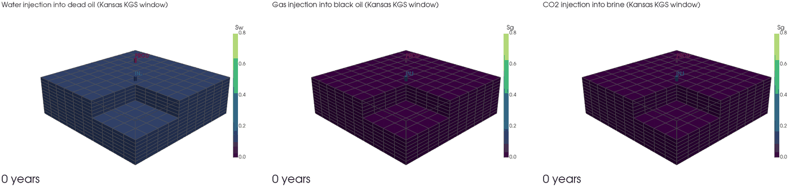

<p align="center"></p>
<p align="center">
<a href="https://doi.org/10.5281/zenodo.23832007"></a> <a href="https://github.com/GeoLarryLai/SubsurfiX/blob/main/LICENSE"></a>
<br>
<a href="https://pypi.org/project/subsurfix/"></a> <a href="https://pypi.org/project/subsurfix/"></a> <a href="https://pepy.tech/projects/subsurfix"></a>
</p>

# SubsurfiX

> [!WARNING]
> **SubsurfiX** is under active development, and many functions are still experimental and not fully validated. Please use with caution.

**SubsurfiX** takes you from a folder of well logs to a checked, correlated log set and a 3D property model you can run flow and heat simulations on. I built it because these steps usually live in separate tools, and every hand-off (cleaning logs, filling gaps, correlating wells, gridding, simulating) is where things get lost or quietly changed. Here it's one project file and one run: every filled value carries a provenance code, so you always know what was measured and what was filled. The engine is written in [Rust](https://www.rust-lang.org), and you drive it from Python or the command line.

## Installation

```bash
pip install subsurfix
```

Python 3.12 or newer. Prebuilt wheels are for macOS arm64; on other systems pip builds from source, which needs
Rust, a C/C++ compiler and libclang. Building from a clone, and installing the [MODFLOW 6](https://www.usgs.gov/software/modflow-6-usgs-modular-hydrologic-model) (the U.S. Geological Survey modular hydrologic model; Langevin et al., 2017) program
for examples 09 and 10, are covered in [`examples/README.md`](examples/README.md#setup).

## Quick start

```python
import subsurfix as sx

toml = sx.write_demo_project("sx_demo")   # a small made-up project, no data needed
sx.prepare_edges(toml)
sx.Project(toml).run()                    # clean, fill, correlate and export the logs
```

To start on your own logs, `sx.init_project("my_project", las_dirs=["las"])` writes a settings file you can edit.
More options, including the command line, are in [`examples/README.md`](examples/README.md#quick-start-details).

## Citation

Lai, L.S.-H. (2026) SubsurfiX. *Zenodo*, [https://doi.org/10.5281/zenodo.23832007](https://doi.org/10.5281/zenodo.23832007)

## Model


*A 3D porosity model built from 60 Kansas wells, the end product of the log-to-model workflow.*

- **Log clean-up and gap filling.** Read LAS files and well surveys, mark bad sections, and fill gaps with rules
  and machine learning ([LightGBM](https://lightgbm.readthedocs.io)). Every value carries a code that says
  whether it was measured or filled.
- **Well correlation.** Match the same beds from well to well automatically, solving all wells together.
- **Grids and properties.** Build regular grids, or corner-point grids with faults (the GRDECL format used by
  industry reservoir tools), and fill them with porosity and rock type by kriging, simulation or machine learning,
  with low/mid/high (P10/P50/P90) cases. Rock types: sandstone, shale, limestone, dolomite and cherty carbonate.
- **Data exchange.** [Leapfrog](https://www.seequent.com/products-solutions/leapfrog-geo/) through
  [OMF](https://github.com/gmggroup/omf) files, and [OpenGeoSys](https://www.opengeosys.org) (OGS, an open-source
  finite-element code for coupled thermal, hydraulic, mechanical and chemical processes; Kolditz et al., 2012)
  mesh files (`.vtu`).

<table>
<tr>
<td width="50%"></td>
<td width="50%"></td>
</tr>
<tr>
<td>One Kansas well: the raw log (grey), what the clean-up kept (black) and the filled samples (red).</td>
<td>A west–east section, by depth (left) and after correlation (right), where the beds line up.</td>
</tr>
<tr>
<td colspan="2"></td>
</tr>
<tr>
<td colspan="2">Porosity in one layer, mapped four ways side by side.</td>
</tr>
</table>

Each step has an executed notebook on open data from the Kansas Geological Survey (KGS) and FORCE 2020; see
[`examples/README.md`](examples/README.md).

## Fundamentals

Flow and heat simulations in SubsurfiX rest on two balances:

- **Mass balance with Darcy's law.** In every small piece of rock, fluid that flows in minus fluid that flows out
  equals the change in fluid stored. Darcy's law says how fast fluid flows: faster through more permeable rock,
  for a bigger pressure difference, and for a thinner (less viscous) fluid. With several fluids (water, oil, gas,
  CO₂), each one has its own balance and they share the pore space.
- **Energy balance (heat transport).** Heat is carried along by moving fluid and also spreads by conduction
  through rock and fluid; the heat stored in a cell changes by what flows in and out.

These equations are solved on a grid of cells. SubsurfiX uses the **finite-volume** method: the model is split into
cells, and whatever leaves one cell enters its neighbour, so mass and energy are conserved exactly. Cells are
connected by two-point flux approximation (TPFA: the flow between two cells depends on their pressure
difference). **Finite-element** methods, as used by OpenGeoSys, are planned
(see Roadmap).

## Method overview

[MRST](https://www.sintef.no/projectweb/mrst/) (MATLAB Reservoir Simulation Toolbox) is SINTEF's open-source
MATLAB toolbox for reservoir simulation (Lie, 2019; Lie and Møyner, 2021). SubsurfiX reimplements some methods from MRST papers in Rust; it does not call MATLAB.

| Method | Purpose | Source / credit | Fluids and heat | Grids | Pros | Cons |
|---|---|---|---|---|---|---|
| **FIM-OBL** (default): fully implicit (FIM: all unknowns solved together each time step) finite-volume solver with operator-based linearization (OBL: fluid properties read from pre-computed tables) | How water, oil, gas or CO₂ move and how heat spreads over time | Method of [open-DARTS](https://gitlab.com/open-darts/open-darts) (open Delft Advanced Research Terra Simulator; Voskov et al., 2024; Voskov, 2017) | Water, water–oil, oil–gas, CO₂–brine; heat | Regular and corner-point (faulted) | Most complete: every fluid system plus heat | Slowest of the three; experimental |
| **MODFLOW 6** through [FloPy](https://github.com/modflowpy/flopy) (the Python package for building and running MODFLOW models; Bakker et al., 2016) | Groundwater flow and heat with a trusted standard code | USGS; groundwater flow (GWF) and energy transport (GWE) models | Water; heat. Not multiphase (single fluid only) | Regular only | Widely tested reference | Water and heat only; needs the `mf6` program |
| **CO₂ vertical-equilibrium (VE) model** (from MRST papers, reimplemented in Rust) | Quick screening of where stored CO₂ goes over decades and how much is trapped | MRST co2lab papers (Nilsen et al.) | CO₂–brine only, constant temperature | Regular and corner-point (top surface) | Runs in seconds; reports structural and residual trapping (example 13 compares it with FIM-OBL on the same case) | Treats CO₂ as a thin layer under the caprock; no dissolution; less detail |
| **Corner-point faulted grids** (GRDECL reader, fault connections from MRST methods) | Using real industry grids with faults | MRST grid methods, reimplemented in Rust | Grid input, not a solver | Corner-point with faults | Real faulted grids for FIM-OBL and VE | Faults are geometric overlaps only; fault-rock properties only through multipliers |

The animation below uses a 5 × 5 km window of the Kansas property model from the examples (60 m thick, split into
10 × 10 × 12 cells of 500 × 500 × 5 m). One injector (INJ) and one producer (PROD) are open in all layers, and a
corner is cut away so you can see inside.

### Same method, different fluids (FIM-OBL)

This compares how three injected fluids move through the same reservoir with the same solver, wells and times:
water pushing oil, gas pushed into a black oil, and CO₂ pushed into brine. Colours show how much of the pore space
the injected fluid fills. In these runs (0.008 m³/s for 40 years, about 5 % of the pore volume; example 12), the
injector pressure at 40 years was 24.8 MPa for water, 14.5 MPa for gas and 13.6 MPa for CO₂, and CO₂ reached the
producer after 18 years; mass-balance errors stayed below 6e-8.

<p align="center"></p>

*How do different injected fluids spread through the same real reservoir?*

**Roadmap:** finite-element methods in the style of OpenGeoSys.

## References

**Porous-media flow (water, oil, gas, CO₂–brine)**
- Langevin, C. D., et al. (2017). Documentation for the MODFLOW 6 groundwater flow model. USGS Techniques and
  Methods 6-A55. <https://doi.org/10.3133/tm6A55>
- Bakker, M., et al. (2016). Scripting MODFLOW model development using Python and FloPy. *Groundwater* 54(5).
  <https://doi.org/10.1111/gwat.12413>
- Peaceman, D. W. (1983). Interpretation of well-block pressures in numerical reservoir simulation with
  nonsquare grid blocks and anisotropic permeability. *SPE Journal* 23(3). <https://doi.org/10.2118/10528-PA>
- Voskov, D., Saifullin, I., Novikov, A., Wapperom, M., et al. (2024). open Delft Advanced Research Terra Simulator
  (open-DARTS). *Journal of Open Source Software*. <https://doi.org/10.21105/joss.06737>
- Voskov, D. V. (2017). Operator-based linearization approach for modeling of multiphase multi-component flow in
  porous media. *Journal of Computational Physics* 337, 275–288. <https://doi.org/10.1016/j.jcp.2017.02.041>
- Khait, M., Voskov, D. V. (2017). Operator-based linearization for general purpose reservoir simulation.
  *Journal of Petroleum Science and Engineering* 157, 990–998. <https://doi.org/10.1016/j.petrol.2017.08.009>
- Spycher, N., Pruess, K. (2005). CO₂–H₂O mixtures in the geological sequestration of CO₂. II. Partitioning in
  chloride brines at 12–100 °C and up to 600 bar. *Geochimica et Cosmochimica Acta* 69(13), 3309–3320.
  <https://doi.org/10.1016/j.gca.2005.01.015>
- Ziabakhsh-Ganji, Z., Kooi, H. (2012). An equation of state for thermodynamic equilibrium of gas mixtures and
  brines to allow simulation of the effects of impurities in subsurface CO₂ storage. *International Journal of
  Greenhouse Gas Control* 11. <https://doi.org/10.1016/j.ijggc.2012.07.025>
- Nordbotten, J. M., Celia, M. A. (2006). Similarity solutions for fluid injection into confined aquifers.
  *Journal of Fluid Mechanics* 561, 307–327. <https://doi.org/10.1017/S0022112006000802>
- Nilsen, H. M., et al. (2011). Field-case simulation of CO₂-plume migration using vertical-equilibrium models.
  *Energy Procedia* 4, 3801–3808. <https://doi.org/10.1016/j.egypro.2011.02.315>
- Nilsen, H. M., Lie, K.-A., Andersen, O. (2016). Fully-implicit simulation of vertical-equilibrium models with
  hysteresis and capillary fringe. *Computational Geosciences* 20, 49–67.
  <https://doi.org/10.1007/s10596-015-9547-y>
- Lie, K.-A. (2019). *An Introduction to Reservoir Simulation Using MATLAB/GNU Octave* (MRST). Cambridge
  University Press. <https://doi.org/10.1017/9781108591416>
- Lie, K.-A., Møyner, O. (eds.) (2021). *Advanced Modeling with the MATLAB Reservoir Simulation Toolbox*. Cambridge
  University Press. <https://doi.org/10.1017/9781009019781>

**Heat transport**
- Ogata, A., Banks, R. B. (1961). A solution of the differential equation of longitudinal dispersion in porous
  media. USGS Professional Paper 411-A. <https://doi.org/10.3133/pp411A>
- Khait, M., Voskov, D. (2018). Operator-based linearization for efficient modeling of geothermal processes.
  *Geothermics* 74, 7–18. <https://doi.org/10.1016/j.geothermics.2018.01.012>
- Kolditz, O., et al. (2012). OpenGeoSys: an open-source initiative for numerical simulation of
  thermo-hydro-mechanical/chemical (THM/C) processes in porous media. *Environmental Earth Sciences* 67.
  <https://doi.org/10.1007/s12665-012-1546-x>
- MODFLOW 6 groundwater energy transport (GWE), USGS. <https://www.usgs.gov/software/modflow-6-usgs-modular-hydrologic-model>
- IAPWS-IF97 water properties (used by FIM-OBL for water). <https://iapws.org/technical-guidance/release/IF97-Rev>

**Well logs, correlation and property modelling**
- Gonzalez, K., et al. (2023). Machine learning workflow for log data. TGS technical library.
  <https://www.tgs.com/technical-library/machinelearningworkflowforlogdata>
- Wheeler, L., Hale, D. (2014). Simultaneous correlation of multiple well logs. *SEG Technical Program Expanded
  Abstracts 2014*. <https://doi.org/10.1190/segam2014-0227.1>
- Sylvester, Z. (2023). Automated multi-well stratigraphic correlation and model building using relative
  geologic time. *Basin Research*. <https://doi.org/10.1111/bre.12787>
- Samant, R., et al. (2025). Enhancing the accuracy of dynamic time warping by integrating stratigraphic
  constraints. *Paleoceanography and Paleoclimatology*. <https://doi.org/10.1029/2024PA005082>
- Daly, C. (2021). An application of an embedded model estimator to a synthetic nonstationary reservoir model.
  *Frontiers in Artificial Intelligence* 4. <https://doi.org/10.3389/frai.2021.624697>
- Daly, C. (2022). An embedded model estimator for non-stationary random functions using multiple secondary
  variables. *Mathematical Geosciences*. <https://doi.org/10.1007/s11004-021-09972-8>
- Meinshausen, N. (2006). Quantile regression forests. *Journal of Machine Learning Research* 7, 983–999.
  <https://jmlr.org/papers/v7/meinshausen06a.html>

**Data sources**
- Kansas Geological Survey (KGS), well logs and formation tops. <https://www.kgs.ku.edu/>
- Bormann, P., et al. (2020). FORCE 2020 well log and lithofacies dataset for machine learning competition.
  Zenodo. <https://doi.org/10.5281/zenodo.4351155>

## Acknowledgements

FIM-OBL follows methods published for [open-DARTS](https://gitlab.com/open-darts/open-darts) and
[OpenGeoSys](https://www.opengeosys.org); it has not been checked as equivalent to either code. The CO₂ VE
relative permeabilities are derived from [MRST](https://www.sintef.no/projectweb/mrst/) (SINTEF Digital, GPL-3.0-or-later).
[MODFLOW 6](https://www.usgs.gov/software/modflow-6-usgs-modular-hydrologic-model) and
[FloPy](https://github.com/modflowpy/flopy) are by the USGS. 3D animations use [PyVista](https://pyvista.org).
Details and data credits are in [`NOTICE`](NOTICE) and the files in `docs/`.
